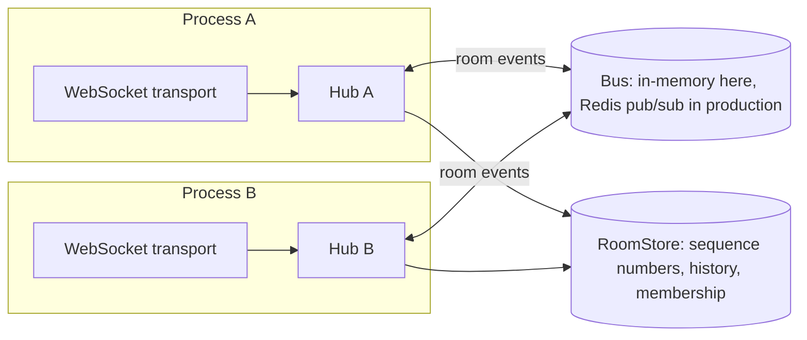

# realtime-chat-server

A WebSocket chat server in TypeScript: rooms, presence, typing indicators, history replay after a dropped connection, and a pub/sub seam so several server processes act as one.

One runtime dependency (`ws`). Node 20+.

## What makes realtime hard, and what this does about it

| Problem | What the server does | Test |
|---|---|---|
| A client drops and reconnects | Messages carry a per-room sequence number. `join` with `since: <last id>` replays exactly what was missed | `a reconnecting client replays exactly what it missed` |
| The sender needs to know its message landed | Optional `clientId` is echoed in an `ack` with the server's id, so optimistic UI can reconcile | `ack maps the client's id to the server's id` |
| One user, several tabs | Presence is reference-counted. "Offline" is announced only when the last tab closes | `presence: online once, offline only when the last tab closes` |
| A slow client stalls everyone | Outbound queue size is checked before each send. A client past the limit is closed with code 1013 | `slow consumers are disconnected instead of buffering forever` |
| A chatty or abusive client | Per-connection rate limit, frame size cap, strict validation of every frame | `rate limit rejects a burst...`, `malformed frames get an error...` |
| Dead connections that look alive | Ping every 30 s; one missed pong terminates the socket | heartbeat in `src/server.ts` |
| More users than one process can hold | Hubs publish room events to a bus and deliver what the bus returns | `two hubs sharing a bus and store behave like one server` |

## Architecture



The `Hub` never touches a socket directly. It talks to a three-member `Connection` interface (`send`, `close`, `bufferedAmount`), so the chat logic is unit-tested with fake connections and no network, and the same code runs behind real WebSockets. Twelve tests cover the hub; three more drive the real server with real `ws` clients.

A message is delivered to local sockets only through the bus, including on the hub that received it. That single path is why a message arrives exactly once whether sender and receiver share a process or not.

## Protocol

Every frame is a JSON object.

```jsonc
// client -> server
{"type": "join", "room": "general", "since": 41}      // since is optional
{"type": "message", "room": "general", "text": "hi", "clientId": "tmp-7"}
{"type": "typing", "room": "general"}
{"type": "leave", "room": "general"}
{"type": "ping"}

// server -> client
{"type": "welcome", "user": "alice"}
{"type": "joined", "room": "general", "members": ["alice", "bob"], "history": [/* messages */]}
{"type": "message", "message": {"id": 42, "room": "general", "user": "bob", "text": "hi", "at": 1794550000000}}
{"type": "ack", "clientId": "tmp-7", "id": 42}
{"type": "presence", "room": "general", "user": "bob", "status": "online"}
{"type": "error", "code": "rate_limited", "detail": "at most 10 messages per 5000 ms"}
```

## Run it

```bash
npm ci
npm test            # 15 tests
npm run dev         # ws://localhost:8080/?user=alice

# in two terminals:
npx wscat -c "ws://localhost:8080/?user=alice"
> {"type":"join","room":"general"}
> {"type":"message","room":"general","text":"hello"}

docker build -t chat . && docker run -p 8080:8080 chat
```

## Honest limits

- **The bus and store are in-memory.** The interfaces (`Bus`, `RoomStore`) are the seam for Redis, and a test proves two hubs cooperate through them, but no Redis adapter ships here. Until one does, this runs as a single process.
- **Authentication is a placeholder.** The default takes `?user=` from the URL. `createChatServer({ authenticate })` is where a real token check goes.
- **History is capped** at the last 200 messages per room and lost on restart.
- **No load numbers are claimed.** This has not been load-tested, so no throughput figures are given.
